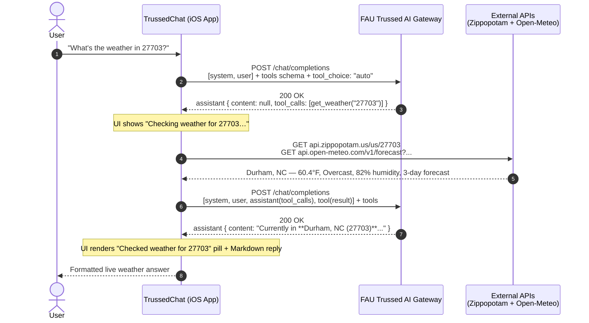

# TrussedChat — Architecture & Design

## 1. Overview

`TrussedChat` is a native SwiftUI iOS chat application built on **FAU CoECS Trussed AI** (`https://trussed.eng.fau.edu/provider/generic/chat/completions`), an OpenAI-compatible chat-completions gateway.

A raw LLM API only predicts text from its training data—it has no clock and cannot reach the internet. `TrussedChat` bridges that gap by wrapping the chat API in an **agentic tool-calling loop** with four built-in, zero-API-key live tools, live progress feedback, and native Markdown rendering.

---

## 2. Multi-Provider Support & Secret Management

### Providers (`LLMProvider` in `TrussedChat/Services/TrussedAPIClient.swift`)

The top segmented picker in `ChatView` switches between three providers without losing your conversation:

| Provider | Enum Case | Default Model | Environment / Config Key |
|---|---|---|---|
| **FAU LLM** | `.faullm` | `gemma4-vibe` | `FAULLM_API_KEY` |
| **ChatGPT** | `.chatgpt` | `gpt-5.6-luna` | `CHATGPT_API_KEY` |
| **Gemini** | `.gemini` | `gemini-3.8-flash` | `GEMINI_API_KEY` |

Each provider's model name can be edited at runtime in **Settings** (`SettingsView`) and persists in `UserDefaults`.

### API Key Resolution Order (`APIKeyResolver`)

Keys are never hardcoded in Swift source or committed to Git. For the active provider, `APIKeyResolver.resolvedAPIKey(for:)` checks three sources in priority order:

1. **In-app Settings (`KeychainStore`)** — Stored in the iOS Keychain per provider, with an automatic `UserDefaults` fallback when running unsigned iOS Simulator builds that lack Keychain entitlements (`errSecMissingEntitlement`).
2. **Xcode Scheme Environment Variables** — `FAULLM_API_KEY`, `CHATGPT_API_KEY`, `GEMINI_API_KEY` (and legacy `TRUSSED_API_KEY` for `.faullm`).
3. **Build Configuration (`Config/Secrets.xcconfig` → `TrussedChat/Info.plist`)** — `Config/Project.xcconfig` defines empty defaults and optionally includes `Config/Secrets.xcconfig` (`#include? "Secrets.xcconfig"`), which is listed in `.gitignore`. `Info.plist` exposes the build settings to `Bundle.main.object(forInfoDictionaryKey:)`. `Config/Secrets.xcconfig.example` stays empty as a tracked template.

---

## 3. How the Agentic Tool-Calling Loop Works

When **Enable Live Tools** is on (the default), `TrussedAPIClient.runAgent(...)` runs a standard OpenAI-compatible function-calling loop of up to **5 tool-calling rounds** per user message:

```text
User prompt
    │
    ▼
1. Build request: [systemPrompt(now), ...conversationHistory] + tools JSON schema
    │
    ▼
2. POST /provider/generic/chat/completions  ──►  parseTurn(data) -> AssistantTurn
    │
    ├── No tool_calls?  ──► Return final text + collected [ToolActivity] to UI
    │
    └── Has tool_calls?
            │
            ▼
        3. Append assistant turn (preserving raw tool_calls verbatim)
            │
            ▼
        4. Update UI progress (e.g. "Checking weather for 27703…")
           Execute each tool locally via AgentTools.execute(name, argumentsJSON)
            │
            ▼
        5. Append each result as { role: "tool", tool_call_id, name, content }
            │
            └── Loop back to Step 2 (up to 5 rounds; final round omits tools to force an answer)
```

### Provider Compatibility Details Handled in `TrussedAPIClient`

- **Optional `content` (`String?`):** All three models (`gemma4-vibe`, `gpt-5.6-luna`, `gemini-3.8-flash`) return `content: null` when issuing `tool_calls`, so `AssistantTurn.content` is decoded as optional.
- **Verbatim `rawToolCalls`:** Gemini embeds long thought signatures inside `tool_calls` IDs (`call_...__thought__...`). `AssistantTurn` keeps the raw `[[String: Any]]` dictionaries and echoes them back unmodified on the next turn.
- **Graceful fallback:** If a model ever rejects the `tools` parameter, the client falls back cleanly to a plain chat completion.

---

## 4. Built-In Live Tools (`TrussedChat/Services/AgentTools.swift`)

All four tools run directly inside the iOS app using public endpoints that require **no additional API keys**:

| Tool Name | Purpose | Backing Service / Implementation |
|---|---|---|
| `get_weather(location)` | Current conditions + 3-day forecast (temp, feels-like, humidity, wind, pressure in hPa & inHg, condition) | 5-digit US ZIP lookup via `api.zippopotam.us/us/<zip>` + city lookup via Open-Meteo Geocoding + live forecast via `api.open-meteo.com/v1/forecast` (WMO weather codes mapped to plain English) |
| `web_search(query)` | Live web search results (top 5 titles, URLs, snippets) | DuckDuckGo HTML endpoint (`html.duckduckgo.com/html/`) with entity decoding and `uddg=` redirect unwrapping, plus Instant Answer / Wikipedia fallback |
| `fetch_webpage(url)` | Read a public webpage referenced in search or by the user | Validates `http://` or `https://` scheme, strips `<script>`, `<style>`, and HTML tags, collapses whitespace, and caps output at ~4,000 characters |
| `get_current_datetime()` | Exact local date, time, day of week, and timezone | `Foundation.Date` / `DateFormatter` / `TimeZone.current` |

In tool mode, `AgentTools.systemPrompt(now:)` injects the current local date, time, and timezone into the system message and instructs the model to call tools for live information rather than claiming it has no internet access.

---

## 5. UI & Presentation Layer

- **Live Progress & Tool Activity (`ChatView.swift`, `ChatMessage.swift`, `ChatViewModel.swift`):**
  - While tools execute, the typing indicator displays real-time status from `AgentTools.progressLabel(...)` (e.g., `"Checking weather for 27703…"` or `"Searching \"...\"…"`).
  - Once finished, each assistant `ChatMessage` stores its `[ToolActivity]` records and renders compact pills above the reply bubble (e.g., `Checked weather for 27703`, `Read espn.com`).
- **Markdown Rendering (`Views/MarkdownText.swift`):**
  - Renders headings, bullet and numbered lists, block quotes, fenced code blocks, and inline Markdown (`**bold**`, `*italic*`, `` `code` ``, and clickable `[links](https://...)`) via SwiftUI `AttributedString(markdown:)`.
- **Side-by-Side Comparison Toggle (`Views/SettingsView.swift`):**
  - **Enable Live Tools** (`TrussedAPIConfiguration.toolsEnabled`, persisted in `UserDefaults`, default `true`) lets you turn off tools and the agent system prompt anytime to compare the raw LLM API directly against the tool-enabled assistant.

---

## 6. Project File Map

```text
TrussedChat/
├── DESIGN.md                           # This architecture & design document
├── Config/
│   ├── Project.xcconfig                # Base build settings; #include? "Secrets.xcconfig"
│   ├── Secrets.xcconfig                # Local API keys (gitignored)
│   └── Secrets.xcconfig.example        # Safe placeholder template (tracked)
├── TrussedChat.xcodeproj/              # Xcode project (iOS Simulator / device)
└── TrussedChat/
    ├── TrussedChatApp.swift            # App entry point
    ├── Info.plist                      # Maps xcconfig key build settings into Bundle.main
    ├── Models/
    │   └── ChatMessage.swift           # ChatRole, ToolActivity, ChatMessage + API payload
    ├── Services/
    │   ├── TrussedAPIClient.swift      # LLMProvider, APIKeyResolver, HTTP client & agent loop
    │   ├── AgentTools.swift            # Tool schemas, system prompt, and 4 live tool runners
    │   └── KeychainStore.swift         # Per-provider Keychain storage + Simulator fallback
    ├── ViewModels/
    │   └── ChatViewModel.swift         # ObservableObject state, persistence, async send flow
    └── Views/
        ├── ChatView.swift              # Provider picker, message list, tool pills, composer
        ├── MarkdownText.swift          # Block + inline Markdown SwiftUI renderer
        └── SettingsView.swift          # Per-provider models/keys + Enable Live Tools toggle
```

---

## 7. End-to-End Sequence Diagram

This Mermaid diagram shows what happens under the covers when you ask *"What's the weather in 27703?"*:



---

## 8. Sample JSON Passed Around (Weather Example)

Below is the exact sequence of JSON payloads exchanged for a single weather question (`27703`).

### Step 1 — App → Trussed AI (Turn 1 Request)

```json
{
  "model": "gpt-5.6-luna",
  "tool_choice": "auto",
  "messages": [
    {
      "role": "system",
      "content": "You are a helpful assistant inside TrussedChat. Current local date and time: Monday, Nov 23, 2026, 9:40 PM EST (America/New_York). Use your tools whenever the user asks for live or current information..."
    },
    {
      "role": "user",
      "content": "What's the weather in 27703?"
    }
  ],
  "tools": [
    {
      "type": "function",
      "function": {
        "name": "get_weather",
        "description": "Get the current weather conditions and 3-day forecast for a US ZIP code or city name.",
        "parameters": {
          "type": "object",
          "properties": {
            "location": {
              "type": "string",
              "description": "City name or 5-digit US ZIP code (for example, '27703' or 'Boca Raton, FL')."
            }
          },
          "required": ["location"]
        }
      }
    }
  ]
}
```

### Step 2 — Trussed AI → App (Turn 1 Response: Model Requests a Tool)

Notice `content` is `null` and the model returns a `tool_calls` array instead of a final answer:

```json
{
  "id": "chatcmpl-example-1",
  "object": "chat.completion",
  "model": "gpt-5.6-luna",
  "choices": [
    {
      "index": 0,
      "finish_reason": "tool_calls",
      "message": {
        "role": "assistant",
        "content": null,
        "tool_calls": [
          {
            "id": "call_abc123",
            "type": "function",
            "function": {
              "name": "get_weather",
              "arguments": "{\"location\":\"27703\"}"
            }
          }
        ]
      }
    }
  ]
}
```

### Step 3 — App Runs `AgentTools.weather(location: "27703")` Locally

The iOS app parses `arguments`, calls Zippopotam (`27703` → Durham, NC `35.994, -78.8986`) and Open-Meteo, and builds a `role: "tool"` message linked to `call_abc123`:

```json
{
  "role": "tool",
  "tool_call_id": "call_abc123",
  "name": "get_weather",
  "content": "Location: Durham, North Carolina (27703)\nCurrent: Overcast, 60.4°F (feels like 58.4°F), Humidity 82%, Wind 8.5 mph NNW, Pressure 1003.7 hPa (29.64 inHg)\nForecast:\n- 2026-11-23: High 62°F / Low 44°F, Light rain (70% precip)\n- 2026-11-24: High 58°F / Low 39°F, Partly cloudy (15% precip)"
}
```

### Step 4 — App → Trussed AI (Turn 2 Request: Send Tool Result Back)

The app sends the full history—including the assistant's `tool_calls` turn verbatim and the new `role: "tool"` result:

```json
{
  "model": "gpt-5.6-luna",
  "tool_choice": "auto",
  "messages": [
    {
      "role": "system",
      "content": "You are a helpful assistant inside TrussedChat..."
    },
    {
      "role": "user",
      "content": "What's the weather in 27703?"
    },
    {
      "role": "assistant",
      "content": null,
      "tool_calls": [
        {
          "id": "call_abc123",
          "type": "function",
          "function": {
            "name": "get_weather",
            "arguments": "{\"location\":\"27703\"}"
          }
        }
      ]
    },
    {
      "role": "tool",
      "tool_call_id": "call_abc123",
      "name": "get_weather",
      "content": "Location: Durham, North Carolina (27703)\nCurrent: Overcast, 60.4°F (feels like 58.4°F)..."
    }
  ],
  "tools": [ ... ]
}
```

### Step 5 — Trussed AI → App (Turn 2 Response: Final Grounded Answer)

Now the model has real live data and replies with a normal `assistant` message (`finish_reason: "stop"`), which `ChatView` displays with the `Checked weather for 27703` pill and `MarkdownText`:

```json
{
  "id": "chatcmpl-example-2",
  "object": "chat.completion",
  "model": "gpt-5.6-luna",
  "choices": [
    {
      "index": 0,
      "finish_reason": "stop",
      "message": {
        "role": "assistant",
        "content": "**Durham, NC (27703) — Current Weather**\n- **Condition:** Overcast\n- **Temperature:** 60.4°F (feels like 58.4°F)\n- **Humidity:** 82%\n- **Wind:** 8.5 mph NNW\n- **Pressure:** 29.64 inHg"
      }
    }
  ]
}
```
